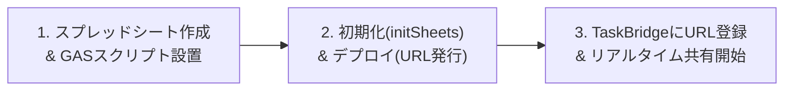

# TaskBridge：Googleスプレッドシート連携・一元管理 導入マニュアル

本システム「TaskBridge」は、**ブラウザ単体（LocalStorage）** での個人利用に加え、**Googleスプレッドシート（無料・共有クラウドデータベース）** と連携させることで、チームメンバー全員での**完全なリアルタイム一元管理・共有**を実現できます。

サーバー代や追加費用は一切不要で、Googleアカウント（無料）が1つあれば**約10分**で設定完了します。

---

## 📌 全体の流れ（3ステップ）

---

## STEP 1：Googleスプレッドシートの作成とスクリプト設置

### 1-1. Googleスプレッドシートを新規作成する
1. [Googleドライブ](https://drive.google.com/) を開きます。
2. 左上の **「＋ 新規」** ＞ **「Google スプレッドシート」** ＞ **「空白のスプレッドシート」** をクリックします。
3. シート名をわかりやすい名前に変更します（例: `TaskBridge_プロジェクト進捗管理`）。

### 1-2. Apps Script エディタを開く
1. 上部メニューバーの **「拡張機能」** ＞ **「Apps Script」** をクリックします。
2. 開いた画面のプロジェクト名（「無題のプロジェクト」）を `TaskBridge_API` などに変更します。

### 1-3. スクリプト（`Code.js`）を貼り付ける
1. 左側のファイル一覧で `コード.gs` が開いていることを確認します。
2. 最初に入っている数行のコードを**すべて削除**してエディタを空にします。
3. TaskBridgeフォルダ内にある **[`Code.js`](file:///c:/Users/BS227/Documents/antigravity/TaskBridge/Code.js)** の内容を最初から最後までコピーし、エディタに貼り付けます。
4. エディタ上部の **フロッピーアイコン（💾 プロジェクトを保存）** をクリックします。

---

## STEP 2：初回初期化とデプロイ（連携URLの発行）

### 2-1. 初期化関数（`initSheets`）を実行する
貼り付けたスクリプトには、必要な5つのシートを自動構築する機能が備わっています。
1. Apps Scriptエディタ上部の関数プルダウン（「デバッグ」の左隣）から **`initSheets`** を選択します。
2. **「実行」** ボタン（▶）をクリックします。

### 2-2. 初回アクセスの承認（Googleセキュリティ確認）
初回実行時のみ、「承認が必要です」というポップアップが出ます：
1. **「権限を確認」** をクリック。
2. ご自身のGoogleアカウントを選択。
3. 「Google はこのアプリを検証していません」という警告画面が出たら、左下の **「詳細」**（または「Advanced」）をクリック。
4. 最下部に表示される **「TaskBridge_API（安全ではないページ）に移動」** をクリック。
5. 要求される権限（スプレッドシートの閲覧・編集）を確認し、右下の **「許可」** をクリック。

> **✅ 成功の確認**:  
> スプレッドシートの画面に戻ると、下部のタブに以下の5つのシートが自動生成され、見出しがカラーリングされていることを確認してください。
> - 📘 **「プロジェクト」**
> - 📗 **「メンバー」**
> - 🔷 **「WBS」**
> - 🟪 **「週次指示」**
> - 📕 **「指示外作業報告」**

### 2-3. ウェブアプリとしてデプロイ（連携URL発行）
1. Apps Scriptエディタ右上の青い **「デプロイ」** ボタン ＞ **「新しいデプロイ」** をクリックします。
2. 左側の歯車アイコン（種類の選択）をクリックし、**「ウェブアプリ」** を選択します。
3. 設定項目を以下のように入力します：
   - **説明**: `TaskBridge API v1`（任意）
   - **次のユーザーとして実行**: `自分 (your-email@gmail.com)`
   - **アクセスできるユーザー**: **`全員`**（※重要: メンバーのブラウザから通信するために「全員」にしてください）
4. 右下の **「デプロイ」** をクリックします。
5. 表示された **「ウェブアプリの URL」**（`https://script.google.com/macros/s/.../exec`）をコピーします。

---

## STEP 3：TaskBridge アプリにURLを登録する

1. TaskBridgeアプリ（`index.html` または `run_app.bat` で起動）を開きます。
2. 画面右上のタブ **「データ管理」** を開きます。
3. 「Googleスプレッドシート連携設定」の入力欄に、先ほどコピーした **ウェブアプリ URL** を貼り付けます。
4. **「接続テスト & クラウドから読み込み」** をクリックします。

> **🎉 これで連携完了です！**
> - スプレッドシートとWebアプリが双方向につながり、メンバーがどこからでも同じWBS・作業指示・進捗報告を共有・一元管理できるようになります。
> - スプレッドシート側で直接セルを編集しても、Webアプリを再読み込みすれば即座に反映されます。
